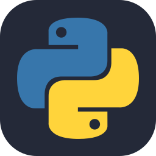
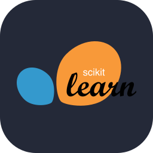
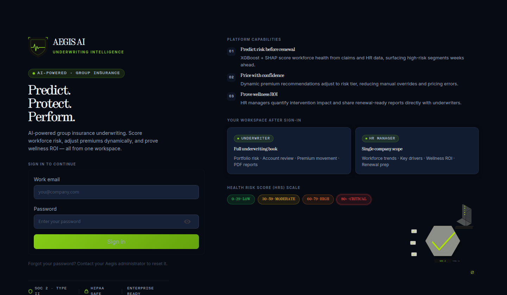
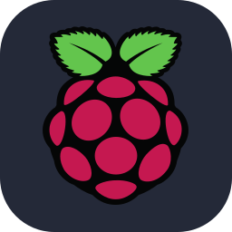
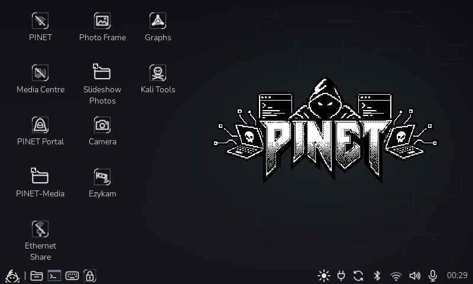
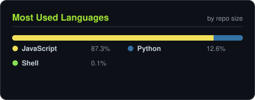

<!-- NAME / TAGLINE - animated typing -->

  

<!-- SOCIALS -->
&nbsp;&nbsp;
&nbsp;&nbsp;
&nbsp;&nbsp;
&nbsp;&nbsp;

  

<!-- BANNER - terminal rupal.sh --live. Generated by scripts/banner.py -->
<picture>
  <source media="(prefers-color-scheme: dark)"  srcset="assets/banner-dark.svg">
  <source media="(prefers-color-scheme: light)" srcset="assets/banner-light.svg">
  
</picture>

  

[About Me](#about-me) • [Flagship Engineering](#flagship-engineering) • [Live GitHub Telemetry](#github-telemetry) • [My StacK](#my-stack) • [Core Competencies](#core-competencies) • [Hobbies & Exploration](#hobbies)

---

## About me

Hi, I'm **Rupal**, Client Success & Technical Operations Lead, broadcasting from Kolkata, India 🇮🇳.
I bridge the gap between enterprise clients, scalable SaaS architecture, and applied AI systems — owning rollouts end-to-end from discovery and API integrations to go-live and telemetry.

- 🏢 **Client Success & Technical Operations at [Vantage Circle](https://www.vantagecircle.com)**: Leading enterprise SaaS onboarding across the Americas, Europe, and India (SAP-ecosystem firms, global business services majors, US energy clients).
- 🎓 **Executive Program in AI for Business at [IIM Lucknow](https://www.iiml.ac.in)**: Applied focus on using Generative AI and agentic systems for client enablement and operations — cutting L&D content production time by ~40%.
- ⚡ **Hands-on Technical Delivery**: Configuring platform customizations through Jenkins pipelines, validating REST integrations in Postman, and engineering SQL telemetry pipelines that anchor executive QBRs.
- 🎯 **A Proven Track Record**: 15+ enterprise rollouts delivered with **zero missed go-lives**, **20% SLA uplift** through P1/P2 escalation leadership, and **30% reduction in early-stage churn**.
- 🤖 **Obsessed with Applied AI & Automation**: Building agentic workflows (FastAPI, XGBoost, Streamlit, Python) that turn manual operational friction into automated pipelines.
- 📜 **Certified Scrum Master (CSM®)** & Google IT Support Professional.
- 💬 Talk to me about **enterprise SaaS onboarding, agentic AI, or workflow automation** and you'll have my full attention.

<a href="#top">↑ Back to Top</a>

---

## 🚀 Flagship Engineering & Systems Architecture

<!-- Featured Repositories & Minimal Previews -->
<table>
<tr>
<td width="50%" align="center" valign="top">

<a href="https://github.com/rupal2k/aegis-ai">
<picture>
  <source media="(prefers-color-scheme: dark)"  srcset="assets/card-aegis-ai-dark.svg">
  <source media="(prefers-color-scheme: light)" srcset="assets/card-aegis-ai-light.svg">
  
</picture>
</a>

  &nbsp;
  &nbsp;
  &nbsp;
  &nbsp;
  

<b>Aegis AI</b> · Health Risk Scoring & Underwriting Dashboard (<a href="https://huggingface.co/spaces/Rupa2k/aegis-ai">Live Demo ↗</a>)

</td>
<td width="50%" align="center" valign="top">

<a href="https://github.com/rupal2k/pinet">
<picture>
  <source media="(prefers-color-scheme: dark)"  srcset="assets/card-pinet-dark.svg">
  <source media="(prefers-color-scheme: light)" srcset="assets/card-pinet-light.svg">
  
</picture>
</a>

  &nbsp;
  &nbsp;
  &nbsp;
  &nbsp;
  

<b>PINET</b> · Portable Cyber-deck OS & Edge Operations Interface

</td>
</tr>
</table>

<a href="#top">↑ Back to Top</a>

---

## 📊 GitHub Analytics & Real-Time Telemetry

<!-- Real-time dynamic GitHub stats that update automatically on every request -->

<table width="100%">
<tr>
<td width="50%" align="center" valign="top">
  
</td>
<td width="50%" align="center" valign="top">
  
</td>
</tr>
<tr>
<td colspan="2" align="center" valign="top">
  
</td>
</tr>
</table>

 

<b>🛡️ View Self-Hosted Vector Cards (Offline &amp; Ad-Block Resilient)</b>

 

<i>Rendered directly by <code>scripts/cards.py</code> via GitHub Actions: stable, fast, and immune to third-party outages.</i>

<table width="100%">
<tr>
<td width="50%" align="center" valign="top">
  <picture>
    <source media="(prefers-color-scheme: dark)"  srcset="assets/card-stats-dark.svg">
    <source media="(prefers-color-scheme: light)" srcset="assets/card-stats-light.svg">
    
  </picture>
</td>
<td width="50%" align="center" valign="top">
  <picture>
    <source media="(prefers-color-scheme: dark)"  srcset="assets/card-top-langs-dark.svg">
    <source media="(prefers-color-scheme: light)" srcset="assets/card-top-langs-light.svg">
    
  </picture>
</td>
</tr>
</table>

<a href="#top">↑ Back to Top</a>

---

## ⚡ My StacK

  &nbsp;
  &nbsp;
  &nbsp;
  &nbsp;
  &nbsp;
    
  &nbsp;
  &nbsp;
  &nbsp;
  &nbsp;
  &nbsp;
  

<a href="#top">↑ Back to Top</a>

---

## 🎯 Core Competencies & Domain Expertise

<table>
<tr>
<td width="50%" align="center" valign="middle">

<!-- Self-rated core competencies radar -->
<picture>
  <source media="(prefers-color-scheme: dark)"  srcset="assets/radar-dark.svg">
  <source media="(prefers-color-scheme: light)" srcset="assets/radar-light.svg">
  
</picture>

</td>
<td width="50%" align="center" valign="middle">

<!-- Technical domain & tooling radar -->
<picture>
  <source media="(prefers-color-scheme: dark)"  srcset="assets/radar-langs-dark.svg">
  <source media="(prefers-color-scheme: light)" srcset="assets/radar-langs-light.svg">
  
</picture>

</td>
</tr>
</table>

<a href="#top">↑ Back to Top</a>

---

## 🏕️ Beyond the Terminal · Wandering & Visual Storytelling

When I'm away from deployment pipelines, API integrations, and terminal prompts, I hit the road to explore offbeat trails, travel, and document life's journeys through visual storytelling.

&nbsp;&nbsp;

  

> *"Hi, I am Rupal Das. This is my journey through life."*  
> Documenting overland travels, offbeat expeditions, cultural landscapes, and unfiltered journeys on my YouTube channel **[Wand3ring_monk](https://www.youtube.com/@wand3ring_monk859)**.

 

<a href="#top">↑ Back to Top</a>

---

<b>Rupal Das</b> · Enterprise Technical Operations, Cloud Delivery & Applied AI Systems · <a href="https://github.com/rupal2k">@rupal2k</a>

