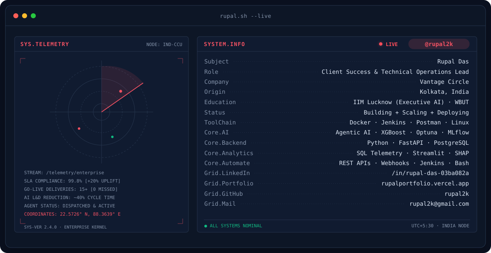
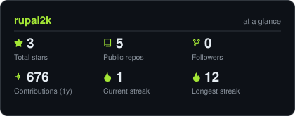
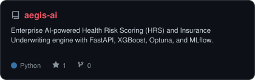
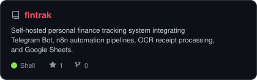
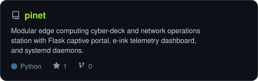

<!-- BANNER - terminal rupal.sh --live. Generated by scripts/banner.py -->
<picture>
  <source media="(prefers-color-scheme: dark)"  srcset="assets/banner-dark.svg">
  <source media="(prefers-color-scheme: light)" srcset="assets/banner-light.svg">
  
</picture>

 

<!-- NAME / TAGLINE - animated typing -->

 

<!-- SOCIALS — LinkedIn brand blue, others themed with Vantage Fit coral accent -->
&nbsp;&nbsp;
&nbsp;&nbsp;
&nbsp;&nbsp;

 

---

## This is me :)

Hi, I'm **Rupal**, Client Success & Technical Operations Lead, broadcasting from Kolkata, India 🇮🇳.
I bridge the gap between enterprise clients, scalable SaaS architecture, and applied AI systems — owning rollouts end-to-end from discovery and API integrations to go-live and telemetry.

- 🏢 **Client Success & Technical Operations at [Vantage Circle](https://www.vantagecircle.com)**: Leading enterprise SaaS onboarding across the Americas, Europe, and India (SAP-ecosystem firms, global business services majors, US energy clients).
- 🎓 **Executive Program in AI for Business at [IIM Lucknow](https://www.iiml.ac.in)**: Applied focus on using Generative AI and agentic systems for client enablement and operations — cutting L&D content production time by ~40%.
- ⚡ **Hands-on Technical Delivery**: Configuring platform customizations through Jenkins pipelines, validating REST integrations in Postman, and engineering SQL telemetry pipelines that anchor executive QBRs.
- 🎯 **A Proven Track Record**: 15+ enterprise rollouts delivered with **zero missed go-lives**, **20% SLA uplift** through P1/P2 escalation leadership, and **30% reduction in early-stage churn**.
- 🤖 **Obsessed with Applied AI & Automation**: Building agentic workflows (FastAPI, XGBoost, n8n, Streamlit) that turn manual operational friction into automated pipelines.
- 📜 **Certified Scrum Master (CSM®)** & Google IT Support Professional.
- 💬 Talk to me about **enterprise SaaS onboarding, agentic AI, or workflow automation** and you'll have my full attention.

 

## my perfect stack`

---

## signals 

<table>
<tr>
<td width="50%" align="center" valign="middle">

<!-- Self-rated core competencies radar -->
<picture>
  <source media="(prefers-color-scheme: dark)"  srcset="assets/radar-dark.svg">
  <source media="(prefers-color-scheme: light)" srcset="assets/radar-light.svg">
  
</picture>

</td>
<td width="50%" align="center" valign="middle">

<!-- Technical domain & tooling radar -->
<picture>
  <source media="(prefers-color-scheme: dark)"  srcset="assets/radar-langs-dark.svg">
  <source media="(prefers-color-scheme: light)" srcset="assets/radar-langs-light.svg">
  
</picture>

</td>
</tr>
</table>

---

## Numbers matter? ohhh yes. 

<!-- Rendered directly by scripts/cards.py into this repo: stable, fast, immune to third-party downtime -->
<picture>
  <source media="(prefers-color-scheme: dark)"  srcset="assets/card-stats-dark.svg">
  <source media="(prefers-color-scheme: light)" srcset="assets/card-stats-light.svg">
  
</picture>

 

<!-- Featured Repositories -->
<table>
<tr>
<td width="50%" align="center" valign="middle">

<a href="https://github.com/rupal2k/aegis-ai">
<picture>
  <source media="(prefers-color-scheme: dark)"  srcset="assets/card-aegis-ai-dark.svg">
  <source media="(prefers-color-scheme: light)" srcset="assets/card-aegis-ai-light.svg">
  
</picture>
</a>

</td>
<td width="50%" align="center" valign="middle">

<a href="https://github.com/rupal2k/fintrak">
<picture>
  <source media="(prefers-color-scheme: dark)"  srcset="assets/card-fintrak-dark.svg">
  <source media="(prefers-color-scheme: light)" srcset="assets/card-fintrak-light.svg">
  
</picture>
</a>

</td>
</tr>
<tr>
<td colspan="2" align="center" valign="middle">

<a href="https://github.com/rupal2k/pinet">
<picture>
  <source media="(prefers-color-scheme: dark)"  srcset="assets/card-pinet-dark.svg">
  <source media="(prefers-color-scheme: light)" srcset="assets/card-pinet-light.svg">
  
</picture>
</a>

</td>
</tr>
</table>

---

` Build with love · @rupal2k `

