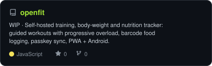
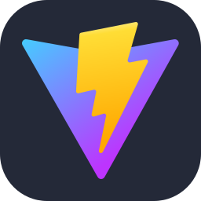
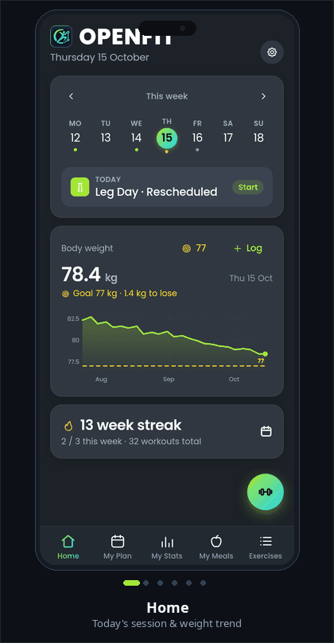
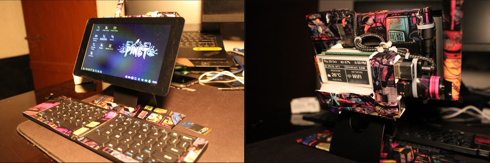
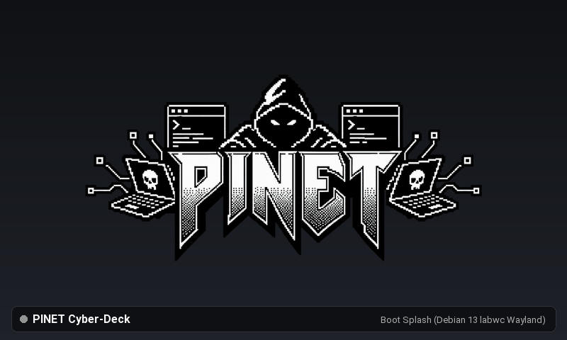
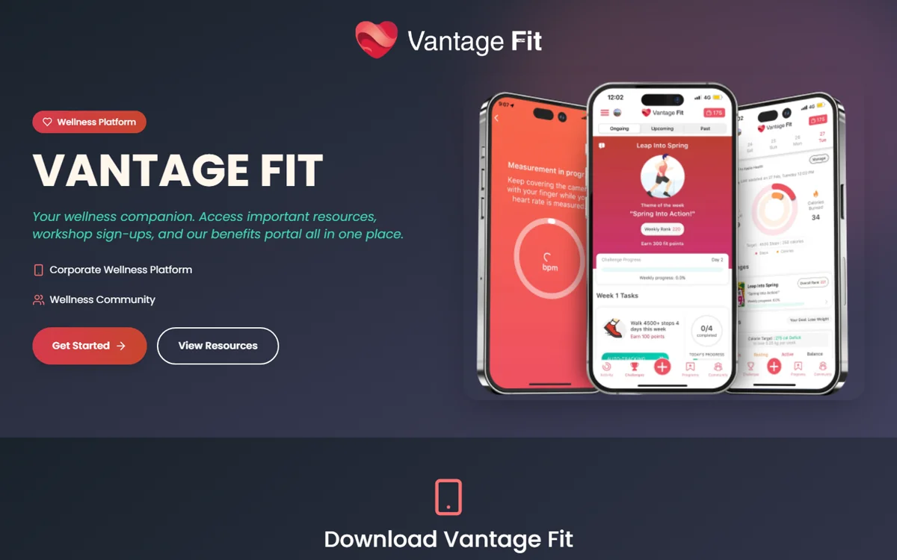
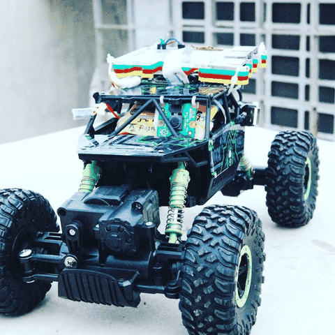

<!-- NAME / TAGLINE - animated typing -->

  

<!-- PROFESSIONAL SOCIALS & CREDENTIALS -->
&nbsp;&nbsp;
&nbsp;&nbsp;
&nbsp;&nbsp;
&nbsp;&nbsp;

  

<!-- TERMINAL BANNER (dark/light adaptive) -->
<picture>
  <source media="(prefers-color-scheme: dark)"  srcset="assets/banner-dark.svg">
  <source media="(prefers-color-scheme: light)" srcset="assets/banner-light.svg">
  
</picture>

  

  <a href="#about-me"><b>About Me</b></a> &nbsp;•&nbsp;
  <a href="#featured-systems"><b>Featured Systems</b></a> &nbsp;•&nbsp;
  <a href="#college-projects"><b>College Projects</b></a> &nbsp;•&nbsp;
  <a href="#technical-stack"><b>Technical Stack</b></a> &nbsp;•&nbsp;
  <a href="#core-competencies"><b>Core Competencies</b></a> &nbsp;•&nbsp;
  <a href="#github-telemetry"><b>GitHub Telemetry</b></a>

---

## 📌 About Me

> **Client Success & Technical Operations Lead** at [Vantage Circle](https://www.vantagecircle.com) · Kolkata, India 🇮🇳  
> Bridging enterprise client operations, scalable SaaS delivery, and applied automation — owning rollouts end-to-end from discovery and API integrations to go-live and operational telemetry.

- 🏢 **Enterprise SaaS Onboarding**: Managing end-to-end platform deployments across the Americas, Europe, and India for Fortune 500 and enterprise accounts (SAP ecosystem, global business services majors, US energy clients).
- 🎓 **Applied AI for Business Operations**: Executive Program at **IIM Lucknow**, focusing on applying Generative AI and automated agent workflows to streamline client enablement and operations.
- ⚡ **Technical Delivery & Integration**: Configuring platform customizations via Jenkins pipelines, validating RESTful integrations in Postman, and engineering SQL telemetry pipelines that anchor executive Quarterly Business Reviews (QBRs).
- 🎯 **Proven Delivery Track Record**: 15+ complex enterprise rollouts delivered with **zero missed go-lives**, **20% SLA uplift** via structured P1/P2 escalation leadership, and **30% reduction in early-stage churn**.
- 🤖 **Pragmatic Automation & Tooling**: Developing Python & edge utilities (FastAPI, Docker, Linux systemd) that convert manual support friction into deterministic pipelines.
- 📜 **Certifications**: **Certified Scrum Master (CSM®)** · Google IT Support Professional.
- 💬 Open to conversations around **enterprise SaaS onboarding, workflow automation, and pragmatic AI applications**.

---

## 🛠️ Featured Systems & Engineering

<!-- OpenFit Spotlight Feature -->
<a href="https://github.com/rupal2k/openfit">
<picture>
  <source media="(prefers-color-scheme: dark)"  srcset="assets/card-openfit-dark.svg">
  <source media="(prefers-color-scheme: light)" srcset="assets/card-openfit-light.svg">
  
</picture>
</a>

  &nbsp;
  &nbsp;
  &nbsp;
  &nbsp;
  &nbsp;
  &nbsp;
  

  &nbsp;
  &nbsp;
  &nbsp;
  &nbsp;
  &nbsp;
  

  <b>OPENFIT</b> · Self-hosted Gym, Body-Weight & Nutrition Tracker with On-Device AI Vision 
  <a href="https://github.com/rupal2k/openfit"><b>Explore Repository ↗</b></a> &nbsp;•&nbsp; <a href="https://github.com/rupal2k/openfit/releases/latest/download/app-release.apk"><b>Download Signed APK ↗</b></a> &nbsp;•&nbsp; <a href="https://github.com/rupal2k/openfit/blob/main/docs/ARCHITECTURE.md"><b>Architecture Docs ↗</b></a>

 

<!-- Aegis AI & PINET Side-by-Side -->
<table width="100%">
<tr>
<td width="50%" align="center" valign="top">

<a href="https://github.com/rupal2k/aegis-ai">
<picture>
  <source media="(prefers-color-scheme: dark)"  srcset="assets/card-aegis-ai-dark.svg">
  <source media="(prefers-color-scheme: light)" srcset="assets/card-aegis-ai-light.svg">
  
</picture>
</a>

  &nbsp;
  &nbsp;
  &nbsp;
  

  &nbsp;
  &nbsp;
  &nbsp;
  &nbsp;
  

  <b>Aegis AI</b> · Health Risk Scoring & Underwriting Analytics 
  <a href="https://github.com/rupal2k/aegis-ai"><b>Repository ↗</b></a> &nbsp;•&nbsp; <a href="https://huggingface.co/spaces/Rupa2k/aegis-ai"><b>Live Demo ↗</b></a>

</td>
<td width="50%" align="center" valign="top">

<a href="https://github.com/rupal2k/pinet">
<picture>
  <source media="(prefers-color-scheme: dark)"  srcset="assets/card-pinet-dark.svg">
  <source media="(prefers-color-scheme: light)" srcset="assets/card-pinet-light.svg">
  
</picture>
</a>

  &nbsp;
  &nbsp;
  

  &nbsp;
  &nbsp;
  &nbsp;
  &nbsp;
  

  <b>PINET</b> · Edge Cyberdeck & Operations Node 
  <a href="https://github.com/rupal2k/pinet"><b>Repository ↗</b></a> &nbsp;•&nbsp; <a href="https://github.com/rupal2k/pinet/blob/main/docs/Device%20Overview.md"><b>Device Overview ↗</b></a>

</td>
</tr>
</table>

 

<!-- Vantage Fit Welcome Site (company project, private repository) -->

<b>Vantage Fit Welcome Site</b> · Onboarding Guide for the Vantage Fit App · Vantage Circle

  &nbsp;
  &nbsp;
  &nbsp;
  &nbsp;
  

  The guide that opens from the <b>Click to view guide</b> banner in each organisation's branded Vantage Fit app. New users install the app, connect a device, learn each task type and join a team, then return to the app. 
  I moved the site from Lovable to Cloudflare with the same behaviour, then made it production-ready: WCAG 2.1 AA contrast, about 95% lighter feature images, a strict security policy, no third-party scripts, and zero console errors. One deployment serves every client's branded app. 
  <a href="https://vfitwelcome.rupal-das.workers.dev/"><b>Live Site ↗</b></a> &nbsp;•&nbsp; Private repository

---

## 🎓 College Projects

<b>Kyra</b> · Raspberry Pi Unmanned Ground Vehicle · 2016

  &nbsp;
  &nbsp;
  &nbsp;
  

  A rock-crawler rover rebuilt around a Raspberry Pi 3B: live camera, lights and motors all controlled over the network, driven through a Pi Motor HAT, with an HC-SR04 ultrasonic sensor for range sensing in reverse. Built in two versions: the 4x4 rock crawler and a tracked tank.

---

## ⚡ Technical Stack & Tooling

| Domain | Core Tooling & Technologies |
| :--- | :--- |
| **Languages & Scripting** | `Python` · `JavaScript (ES6+)` · `SQL` · `Bash` · `HTML5` · `CSS3` |
| **Backend & Integration** | `FastAPI` · `Flask` · `Node.js` · `RESTful APIs` · `Postman` · `Webhooks` |
| **Frontend & Mobile** | `React` · `Vite` · `Capacitor (Android)` · `PWA` · `Tailwind CSS` |
| **Cloud, DevOps & Systems** | `Linux (Debian / Arch)` · `Docker` · `Jenkins CI/CD` · `GitHub Actions` · `Nginx` |
| **Databases & Edge Systems** | `PostgreSQL` · `SQLite / IndexedDB` · `Raspberry Pi (Hardware I2C/SPI)` · `Scikit-Learn` |

---

## 🎯 Core Competencies & Domain Expertise

<table>
<tr>
<td width="50%" align="center" valign="middle">

<!-- Operational & domain competencies radar -->
<picture>
  <source media="(prefers-color-scheme: dark)"  srcset="assets/radar-dark.svg">
  <source media="(prefers-color-scheme: light)" srcset="assets/radar-light.svg">
  
</picture>

<b>Operational Leadership & Client Delivery</b>

</td>
<td width="50%" align="center" valign="middle">

<!-- Technical domain & tooling radar -->
<picture>
  <source media="(prefers-color-scheme: dark)"  srcset="assets/radar-langs-dark.svg">
  <source media="(prefers-color-scheme: light)" srcset="assets/radar-langs-light.svg">
  
</picture>

<b>Technical Architecture & Systems Tooling</b>

</td>
</tr>
</table>

---

## 📊 Live GitHub Telemetry

<table>
<tr>
<td width="50%" align="center" valign="top">
  <picture>
    <source media="(prefers-color-scheme: dark)" srcset="assets/card-stats-dark.svg">
    <source media="(prefers-color-scheme: light)" srcset="assets/card-stats-light.svg">
    
  </picture>
</td>
<td width="50%" align="center" valign="top">
  <picture>
    <source media="(prefers-color-scheme: dark)" srcset="assets/card-top-langs-dark.svg">
    <source media="(prefers-color-scheme: light)" srcset="assets/card-top-langs-light.svg">
    
  </picture>
</td>
</tr>
</table>

---

<b>Rupal Das</b> · Enterprise Technical Operations, Client Success & Applied AI Systems · <a href="https://github.com/rupal2k">@rupal2k</a>

<a href="#top">↑ Back to Top</a>

